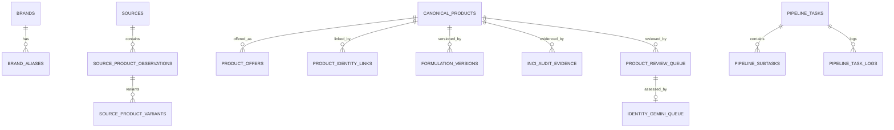

# SkinSync SQLite database reference

**Source of truth (2026-10-25):** `api/pipeline/db_manager.py`, `api/pipeline/aggregation_schema.py` and `api/pipeline/identity_review.py`. Inventory derived from their `CREATE TABLE IF NOT EXISTS` SQL. This documents **declared DDL**, not observed production row counts or undocumented custom SQLite alterations. Run `PRAGMA table_info` on the deployed file to determine its actual schema.

## Storage and initialization

- Default database is `api/skincare.db`; override using `SKINSYNC_DB_PATH`. `get_connection` sets SQLite WAL, synchronous=NORMAL, foreign_keys=ON and 60,000 ms busy timeout.
- The supported initializer is `pipeline.db_manager.init_db`. It creates older catalog and telemetry tables, calls `init_aggregation_schema`, initializes brands/taxonomy, populates the source registry, and adds missing columns. It preserves existing canonical IDs.
- `identity_gemini_queue` can be initialized lazily when the review API first accesses it, but full `init_db` remains the migration entrypoint. `canonical_identity_reviews` is created by its own `init_identity_review_db`.
- Historical `products` rows are **retailer product records**; `canonical_products` represents durable product identity; `product_offers` represents variant- and retailer-specific stock/price; `source_product_observations` represents source evidence snapshots. These IDs are not interchangeable.

## Relationships



This is a **conceptual** ownership graph. Enforced foreign keys and uniqueness follow the DDL, which should be consulted rather than inferred from every arrow.

## Ownership and update rules

| System operation | Tables primarily involved | Important rule |
|---|---|---|
| Source ingestion | `sources`, `source_product_observations`, `source_product_variants`, `canonical_products`, `product_identity_links`, `product_offers` | An imported source observation can stage a provisional canonical; it cannot publish unverified INCI |
| Offer-only price/stock refresh | `product_offers`, canonical price aggregates | Never create unknown products/variants or change identity/formula |
| Exact-identity review | `product_review_queue`, `canonical_identity_history`, `product_identity_links` | Re-review changed evidence, preserve audited decisions |
| Gemini product matching | `identity_gemini_queue` plus review/history tables | Gemini verdict/confidence differs from a committed action; saved verdicts can be replayed at ≥0.90 under deterministic safeguards |
| Split/merge | `canonical_identity_history`, `canonical_redirects`, `canonical_identity_constraints` | Preserve IDs and cannot-link decisions; distinct variants may be split into provisional canonicals |
| INCI publication | `canonical_products`, `formulation_versions`, `inci_audit_evidence`, `formulation_resolution_queue` | Complete, identity-checked ingredient evidence only; do not write directly from arbitrary web/LLM candidates |
| Task orchestration | `pipeline_tasks`, `pipeline_subtasks`, `pipeline_task_logs`, `scrape_checkpoints` | Job creation is not job success |
| Quotas | `api_rate_limits`, `api_request_log` | Persist request use and daily limits |
| Source evaluation | `source_evaluations`, `source_evaluation_labels`, `source_evaluation_results`, `reconciliation_previews` | Finalized evaluation/previews protected by immutability triggers |

## Declared table and column inventory

The column tables below report base DDL; additive migrations are described after this inventory.


### Legacy catalog, reference, jobs

#### `stores`

Source: [`api/pipeline/db_manager.py`](../api/pipeline/db_manager.py).

| Column | Declared SQLite definition |
|---|---|
| `id` | `TEXT PRIMARY KEY` |
| `name` | `TEXT NOT NULL` |
| `domain` | `TEXT NOT NULL UNIQUE` |
| `platform` | `TEXT NOT NULL DEFAULT 'shopify'` |
| `is_active` | `INTEGER NOT NULL DEFAULT 1` |
| `last_sync_at` | `TIMESTAMP` |
| `total_products` | `INTEGER DEFAULT 0` |

#### `products`

Source: [`api/pipeline/db_manager.py`](../api/pipeline/db_manager.py).

| Column | Declared SQLite definition |
|---|---|
| `id` | `INTEGER PRIMARY KEY AUTOINCREMENT` |
| `store_id` | `TEXT NOT NULL` |
| `store_product_id` | `TEXT` |
| `handle` | `TEXT` |
| `title` | `TEXT NOT NULL` |
| `clean_title` | `TEXT` |
| `brand` | `TEXT NOT NULL` |
| `category` | `TEXT NOT NULL` |
| `price` | `REAL NOT NULL DEFAULT 0.0` |
| `compare_at_price` | `REAL DEFAULT 0.0` |
| `is_available` | `INTEGER NOT NULL DEFAULT 1` |
| `image_url` | `TEXT` |
| `product_url` | `TEXT NOT NULL UNIQUE` |
| `description_html` | `TEXT` |
| `ingredients_raw` | `TEXT` |
| `ingredients_parsed` | `TEXT` |
| `actives` | `TEXT` |
| `ingredient_source` | `TEXT` |
| `inci_matched_name` | `TEXT` |
| `inci_vector_score` | `REAL` |
| `inci_token_score` | `REAL` |
| `inci_hybrid_score` | `REAL` |
| `inci_cross_score` | `REAL` |
| `inci_jev_score` | `REAL` |
| `inci_gemini_score` | `REAL` |
| `inci_safeguard_log` | `TEXT` |
| `gate1_quality_status` | `TEXT` |
| `gate2_safeguard_status` | `TEXT` |
| `gate3_active_status` | `TEXT` |
| `gate4_cross_status` | `TEXT` |
| `gate4_jev_status` | `TEXT` |
| `gate4_gemini_status` | `TEXT` |
| `canonical_product_id` | `INTEGER` |
| `created_at` | `TIMESTAMP DEFAULT CURRENT_TIMESTAMP` |
| `updated_at` | `TIMESTAMP DEFAULT CURRENT_TIMESTAMP` |

Constraints: `'skinsafe_matched'`; `'curated' inci_matched_id INTEGER`; `FOREIGN KEY (store_id) REFERENCES stores(id)`.

#### `price_history`

Source: [`api/pipeline/db_manager.py`](../api/pipeline/db_manager.py).

| Column | Declared SQLite definition |
|---|---|
| `id` | `INTEGER PRIMARY KEY AUTOINCREMENT` |
| `product_id` | `INTEGER NOT NULL` |
| `old_price` | `REAL NOT NULL` |
| `new_price` | `REAL NOT NULL` |
| `changed_at` | `TIMESTAMP DEFAULT CURRENT_TIMESTAMP` |

Constraints: `FOREIGN KEY (product_id) REFERENCES products(id) ON DELETE CASCADE`.

#### `inci_reference`

Source: [`api/pipeline/db_manager.py`](../api/pipeline/db_manager.py).

| Column | Declared SQLite definition |
|---|---|
| `id` | `INTEGER PRIMARY KEY AUTOINCREMENT` |
| `brand` | `TEXT NOT NULL` |
| `product_name` | `TEXT NOT NULL` |
| `ingredients` | `TEXT NOT NULL` |
| `source` | `TEXT DEFAULT 'skinsafe'` |
| `embedding` | `BLOB` |

#### `sync_runs`

Source: [`api/pipeline/db_manager.py`](../api/pipeline/db_manager.py).

| Column | Declared SQLite definition |
|---|---|
| `id` | `INTEGER PRIMARY KEY AUTOINCREMENT` |
| `store_id` | `TEXT NOT NULL` |
| `status` | `TEXT NOT NULL` |
| `products_added` | `INTEGER DEFAULT 0` |
| `products_updated` | `INTEGER DEFAULT 0` |
| `price_changes` | `INTEGER DEFAULT 0` |
| `error_message` | `TEXT` |
| `started_at` | `TIMESTAMP DEFAULT CURRENT_TIMESTAMP` |
| `completed_at` | `TIMESTAMP` |

Constraints: `'success'`; `'failed' products_fetched INTEGER DEFAULT 0`.

#### `api_rate_limits`

Source: [`api/pipeline/db_manager.py`](../api/pipeline/db_manager.py).

| Column | Declared SQLite definition |
|---|---|
| `provider` | `TEXT NOT NULL` |
| `usage_date` | `TEXT NOT NULL` |
| `request_count` | `INTEGER NOT NULL DEFAULT 0` |
| `last_request_ts` | `REAL NOT NULL DEFAULT 0.0` |
| `token_count` | `INTEGER NOT NULL DEFAULT 0` |
| `is_exhausted` | `INTEGER NOT NULL DEFAULT 0` |
| `exhausted_until` | `REAL NOT NULL DEFAULT 0.0` |

Constraints: `PRIMARY KEY (provider, usage_date)`.

#### `api_request_log`

Source: [`api/pipeline/db_manager.py`](../api/pipeline/db_manager.py).

| Column | Declared SQLite definition |
|---|---|
| `id` | `INTEGER PRIMARY KEY AUTOINCREMENT` |
| `provider` | `TEXT NOT NULL` |
| `ts` | `REAL NOT NULL` |
| `tokens` | `INTEGER NOT NULL DEFAULT 0` |

#### `ingredient_synonyms`

Source: [`api/pipeline/db_manager.py`](../api/pipeline/db_manager.py).

| Column | Declared SQLite definition |
|---|---|
| `id` | `INTEGER PRIMARY KEY AUTOINCREMENT` |
| `alias` | `TEXT NOT NULL UNIQUE` |
| `canonical_name` | `TEXT NOT NULL` |
| `category` | `TEXT DEFAULT 'general'` |

Constraints: `'fragrance'`; `'surfactant'`; `'emollient'`; `'active'`; `etc. created_at TIMESTAMP DEFAULT CURRENT_TIMESTAMP`.

#### `clinical_ingredients`

Source: [`api/pipeline/db_manager.py`](../api/pipeline/db_manager.py).

| Column | Declared SQLite definition |
|---|---|
| `id` | `INTEGER PRIMARY KEY AUTOINCREMENT` |
| `inci` | `TEXT NOT NULL UNIQUE` |
| `common_name` | `TEXT` |
| `functional_type` | `TEXT` |
| `comedogenicity` | `INTEGER NOT NULL DEFAULT 0` |
| `irritancy` | `INTEGER NOT NULL DEFAULT 0` |
| `tags` | `TEXT` |
| `evidence` | `TEXT` |
| `contraindications` | `TEXT` |
| `notes` | `TEXT` |
| `created_at` | `TIMESTAMP DEFAULT CURRENT_TIMESTAMP` |
| `updated_at` | `TIMESTAMP DEFAULT CURRENT_TIMESTAMP` |

#### `ingredient_whitelist`

Source: [`api/pipeline/db_manager.py`](../api/pipeline/db_manager.py).

| Column | Declared SQLite definition |
|---|---|
| `id` | `INTEGER PRIMARY KEY AUTOINCREMENT` |
| `name` | `TEXT NOT NULL UNIQUE COLLATE NOCASE` |
| `canonical_name` | `TEXT` |
| `category` | `TEXT DEFAULT 'general'` |
| `created_at` | `TIMESTAMP DEFAULT CURRENT_TIMESTAMP` |
| `updated_at` | `TIMESTAMP DEFAULT CURRENT_TIMESTAMP` |

Constraints: `'botanical'`; `'emollient'`; `'humectant'`; `'preservative'`; `'surfactant'`; `'general' is_active INTEGER NOT NULL DEFAULT 1`.

#### `pipeline_tasks`

Source: [`api/pipeline/db_manager.py`](../api/pipeline/db_manager.py).

| Column | Declared SQLite definition |
|---|---|
| `task_id` | `TEXT PRIMARY KEY` |
| `task_type` | `TEXT NOT NULL` |
| `target_source` | `TEXT` |
| `status` | `TEXT NOT NULL DEFAULT 'pending'` |
| `fields` | `TEXT` |
| `params` | `TEXT` |
| `total_items` | `INTEGER DEFAULT 0` |
| `processed_items` | `INTEGER DEFAULT 0` |
| `successful_items` | `INTEGER DEFAULT 0` |
| `failed_items` | `INTEGER DEFAULT 0` |
| `skipped_items` | `INTEGER DEFAULT 0` |
| `progress_percent` | `REAL DEFAULT 0.0` |
| `current_stage` | `TEXT` |
| `error_message` | `TEXT` |
| `metadata` | `TEXT` |
| `started_at` | `TIMESTAMP` |
| `completed_at` | `TIMESTAMP` |
| `duration_seconds` | `REAL` |
| `created_at` | `TIMESTAMP DEFAULT CURRENT_TIMESTAMP` |
| `updated_at` | `TIMESTAMP DEFAULT CURRENT_TIMESTAMP` |

#### `pipeline_subtasks`

Source: [`api/pipeline/db_manager.py`](../api/pipeline/db_manager.py).

| Column | Declared SQLite definition |
|---|---|
| `subtask_id` | `TEXT PRIMARY KEY` |
| `task_id` | `TEXT NOT NULL` |
| `step_name` | `TEXT NOT NULL` |
| `step_index` | `INTEGER DEFAULT 0` |
| `total_steps` | `INTEGER DEFAULT 1` |
| `status` | `TEXT NOT NULL DEFAULT 'pending'` |
| `items_count` | `INTEGER DEFAULT 0` |
| `items_succeeded` | `INTEGER DEFAULT 0` |
| `items_failed` | `INTEGER DEFAULT 0` |
| `error_message` | `TEXT` |
| `metadata` | `TEXT` |
| `started_at` | `TIMESTAMP` |
| `completed_at` | `TIMESTAMP` |
| `duration_seconds` | `REAL` |
| `created_at` | `TIMESTAMP DEFAULT CURRENT_TIMESTAMP` |
| `updated_at` | `TIMESTAMP DEFAULT CURRENT_TIMESTAMP` |

Constraints: `FOREIGN KEY (task_id) REFERENCES pipeline_tasks(task_id) ON DELETE CASCADE`.

#### `pipeline_task_logs`

Source: [`api/pipeline/db_manager.py`](../api/pipeline/db_manager.py).

| Column | Declared SQLite definition |
|---|---|
| `id` | `INTEGER PRIMARY KEY AUTOINCREMENT` |
| `task_id` | `TEXT NOT NULL` |
| `subtask_id` | `TEXT` |
| `level` | `TEXT NOT NULL DEFAULT 'INFO'` |
| `message` | `TEXT NOT NULL` |
| `context_data` | `TEXT` |
| `created_at` | `TIMESTAMP DEFAULT CURRENT_TIMESTAMP` |

Constraints: `FOREIGN KEY (task_id) REFERENCES pipeline_tasks(task_id) ON DELETE CASCADE`; `FOREIGN KEY (subtask_id) REFERENCES pipeline_subtasks(subtask_id) ON DELETE SET NULL`.

#### `scrape_checkpoints`

Source: [`api/pipeline/db_manager.py`](../api/pipeline/db_manager.py).

| Column | Declared SQLite definition |
|---|---|
| `store_id` | `TEXT PRIMARY KEY` |
| `last_task_id` | `TEXT` |
| `last_page_scraped` | `INTEGER DEFAULT 0` |
| `total_pages_detected` | `INTEGER DEFAULT 0` |
| `total_products_scraped` | `INTEGER DEFAULT 0` |
| `last_scraped_at` | `TIMESTAMP` |
| `last_successful_sync_at` | `TIMESTAMP` |
| `sync_cursor` | `TEXT` |
| `status` | `TEXT DEFAULT 'idle'` |
| `metadata` | `TEXT` |
| `updated_at` | `TIMESTAMP DEFAULT CURRENT_TIMESTAMP` |

Constraints: `FOREIGN KEY (store_id) REFERENCES stores(id) ON DELETE CASCADE`; `FOREIGN KEY (last_task_id) REFERENCES pipeline_tasks(task_id) ON DELETE SET NULL`.

#### `canonical_products`

Source: [`api/pipeline/db_manager.py`](../api/pipeline/db_manager.py).

| Column | Declared SQLite definition |
|---|---|
| `id` | `INTEGER PRIMARY KEY AUTOINCREMENT` |
| `canonical_title` | `TEXT NOT NULL` |
| `brand` | `TEXT NOT NULL` |
| `category` | `TEXT NOT NULL` |
| `normalized_key` | `TEXT NOT NULL UNIQUE` |
| `ingredients_raw` | `TEXT` |
| `ingredients_parsed` | `TEXT` |
| `actives` | `TEXT` |
| `ingredient_source` | `TEXT` |
| `inci_matched_id` | `INTEGER` |
| `min_price` | `REAL DEFAULT 0.0` |
| `max_price` | `REAL DEFAULT 0.0` |
| `store_count` | `INTEGER DEFAULT 1` |
| `primary_image_url` | `TEXT` |
| `created_at` | `TIMESTAMP DEFAULT CURRENT_TIMESTAMP` |
| `updated_at` | `TIMESTAMP DEFAULT CURRENT_TIMESTAMP` |

#### `inci_audit_evidence`

Source: [`api/pipeline/db_manager.py`](../api/pipeline/db_manager.py).

| Column | Declared SQLite definition |
|---|---|
| `id` | `INTEGER PRIMARY KEY AUTOINCREMENT` |
| `canonical_product_id` | `INTEGER NOT NULL` |
| `source_name` | `TEXT NOT NULL` |
| `evidence_url` | `TEXT` |
| `evidence_hash` | `TEXT` |
| `raw_ingredients_found` | `TEXT` |
| `parsed_tokens` | `TEXT` |
| `confidence_score` | `REAL` |
| `completeness` | `TEXT DEFAULT 'full'` |
| `validation_flags` | `TEXT` |
| `audited_by` | `TEXT DEFAULT 'pipeline'` |
| `created_at` | `TIMESTAMP DEFAULT CURRENT_TIMESTAMP` |

Constraints: `'openbeauty'`; `'langsearch_inkeedecoder'`; `'curated_v10'`; `'admin_override' source_record_id TEXT`; `'partial'`; `'unverified' decision TEXT NOT NULL`; `'candidate_evidence'`; `'rejected_discrepancy' discrepancy_notes TEXT`; `FOREIGN KEY (canonical_product_id) REFERENCES canonical_products(id) ON DELETE CASCADE`.


### Brand, source, identity and offers

#### `brands`

Source: [`api/pipeline/aggregation_schema.py`](../api/pipeline/aggregation_schema.py).

| Column | Declared SQLite definition |
|---|---|
| `id` | `INTEGER PRIMARY KEY` |
| `name` | `TEXT NOT NULL UNIQUE` |
| `status` | `TEXT NOT NULL DEFAULT 'verified'` |

#### `brand_aliases`

Source: [`api/pipeline/aggregation_schema.py`](../api/pipeline/aggregation_schema.py).

| Column | Declared SQLite definition |
|---|---|
| `alias` | `TEXT PRIMARY KEY` |
| `brand_id` | `INTEGER NOT NULL REFERENCES brands(id)` |
| `approved_by` | `TEXT NOT NULL` |
| `created_at` | `TEXT DEFAULT CURRENT_TIMESTAMP` |

#### `product_taxonomy`

Source: [`api/pipeline/aggregation_schema.py`](../api/pipeline/aggregation_schema.py).

| Column | Declared SQLite definition |
|---|---|
| `id` | `TEXT PRIMARY KEY` |
| `label` | `TEXT NOT NULL` |
| `vertical` | `TEXT NOT NULL` |
| `parent_id` | `TEXT` |
| `is_skincare` | `INTEGER NOT NULL` |

#### `sources`

Source: [`api/pipeline/aggregation_schema.py`](../api/pipeline/aggregation_schema.py).

| Column | Declared SQLite definition |
|---|---|
| `id` | `TEXT PRIMARY KEY` |
| `name` | `TEXT NOT NULL` |
| `domain` | `TEXT NOT NULL UNIQUE` |
| `source_type` | `TEXT NOT NULL CHECK(source_type IN ('retailer','manufacturer','reference'))` |
| `adapter_type` | `TEXT NOT NULL` |
| `market` | `TEXT NOT NULL` |
| `language` | `TEXT NOT NULL DEFAULT 'en'` |
| `provides_prices` | `INTEGER NOT NULL DEFAULT 0` |
| `provides_inci` | `INTEGER NOT NULL DEFAULT 1` |
| `reliability` | `TEXT NOT NULL DEFAULT 'unvalidated'` |
| `wave` | `INTEGER NOT NULL DEFAULT 1` |
| `enabled` | `INTEGER NOT NULL DEFAULT 0` |
| `publish_enabled` | `INTEGER NOT NULL DEFAULT 0` |
| `section_rules` | `TEXT NOT NULL DEFAULT '{}'` |
| `rate_limit_seconds` | `REAL NOT NULL DEFAULT 1` |
| `last_successful_sync` | `TEXT` |

#### `source_product_observations`

Source: [`api/pipeline/aggregation_schema.py`](../api/pipeline/aggregation_schema.py).

| Column | Declared SQLite definition |
|---|---|
| `id` | `INTEGER PRIMARY KEY` |
| `source_id` | `TEXT NOT NULL REFERENCES sources(id)` |
| `source_product_id` | `TEXT NOT NULL` |
| `source_url` | `TEXT NOT NULL` |
| `raw_title` | `TEXT NOT NULL` |
| `raw_brand` | `TEXT` |
| `raw_category` | `TEXT` |
| `source_gtin` | `TEXT` |
| `manufacturer_sku` | `TEXT` |
| `description` | `TEXT` |
| `images` | `TEXT NOT NULL DEFAULT '[]'` |
| `ingredient_text` | `TEXT` |
| `ingredient_section_type` | `TEXT` |
| `market` | `TEXT` |
| `language` | `TEXT` |
| `observed_at` | `TEXT NOT NULL` |
| `payload_hash` | `TEXT NOT NULL` |
| `raw_payload` | `TEXT NOT NULL` |
| `identity_attributes` | `TEXT NOT NULL` |
| `classification` | `TEXT NOT NULL` |

Constraints: `UNIQUE(source_id,source_product_id,payload_hash)`.

#### `source_product_variants`

Source: [`api/pipeline/aggregation_schema.py`](../api/pipeline/aggregation_schema.py).

| Column | Declared SQLite definition |
|---|---|
| `id` | `INTEGER PRIMARY KEY` |
| `observation_id` | `INTEGER NOT NULL REFERENCES source_product_observations(id)` |
| `source_variant_id` | `TEXT NOT NULL` |
| `sku` | `TEXT` |
| `gtin` | `TEXT` |
| `title` | `TEXT` |
| `attributes` | `TEXT NOT NULL` |

Constraints: `UNIQUE(observation_id,source_variant_id)`.

#### `product_identity_links`

Source: [`api/pipeline/aggregation_schema.py`](../api/pipeline/aggregation_schema.py).

| Column | Declared SQLite definition |
|---|---|
| `id` | `INTEGER PRIMARY KEY` |
| `source_id` | `TEXT NOT NULL` |
| `source_product_id` | `TEXT NOT NULL` |
| `canonical_product_id` | `INTEGER REFERENCES canonical_products(id)` |
| `status` | `TEXT NOT NULL CHECK(status IN ('accepted','rejected','pending'))` |
| `method` | `TEXT NOT NULL` |
| `evidence` | `TEXT NOT NULL` |
| `reviewed_by` | `TEXT` |
| `updated_at` | `TEXT DEFAULT CURRENT_TIMESTAMP` |

Constraints: `UNIQUE(source_id,source_product_id,canonical_product_id)`.

#### `canonical_product_aliases`

Source: [`api/pipeline/aggregation_schema.py`](../api/pipeline/aggregation_schema.py).

| Column | Declared SQLite definition |
|---|---|
| `id` | `INTEGER PRIMARY KEY` |
| `canonical_product_id` | `INTEGER NOT NULL REFERENCES canonical_products(id)` |
| `alias_type` | `TEXT NOT NULL` |
| `alias_value` | `TEXT NOT NULL` |
| `source_id` | `TEXT NOT NULL DEFAULT ''` |
| `verified` | `INTEGER NOT NULL DEFAULT 0` |

Constraints: `UNIQUE(canonical_product_id,alias_type,alias_value,source_id)`.

#### `canonical_identity_constraints`

Source: [`api/pipeline/aggregation_schema.py`](../api/pipeline/aggregation_schema.py).

| Column | Declared SQLite definition |
|---|---|
| `left_id` | `INTEGER NOT NULL` |
| `right_id` | `INTEGER NOT NULL` |
| `relation` | `TEXT NOT NULL CHECK(relation IN ('cannot_link','same_identity'))` |
| `reviewed_by` | `TEXT NOT NULL` |
| `reason` | `TEXT NOT NULL` |

Constraints: `PRIMARY KEY(left_id,right_id)`; `CHECK(left_id < right_id)`.

#### `canonical_identity_history`

Source: [`api/pipeline/aggregation_schema.py`](../api/pipeline/aggregation_schema.py).

| Column | Declared SQLite definition |
|---|---|
| `id` | `INTEGER PRIMARY KEY` |
| `operation` | `TEXT NOT NULL` |
| `canonical_product_id` | `INTEGER NOT NULL` |
| `target_id` | `INTEGER` |
| `before_state` | `TEXT NOT NULL` |
| `after_state` | `TEXT NOT NULL` |
| `reviewed_by` | `TEXT NOT NULL` |
| `reason` | `TEXT NOT NULL` |
| `created_at` | `TEXT DEFAULT CURRENT_TIMESTAMP` |
| `reverses_id` | `INTEGER` |

#### `canonical_redirects`

Source: [`api/pipeline/aggregation_schema.py`](../api/pipeline/aggregation_schema.py).

| Column | Declared SQLite definition |
|---|---|
| `canonical_product_id` | `INTEGER PRIMARY KEY` |
| `target_id` | `INTEGER NOT NULL` |
| `history_id` | `INTEGER NOT NULL REFERENCES canonical_identity_history(id)` |

#### `product_review_queue`

Source: [`api/pipeline/aggregation_schema.py`](../api/pipeline/aggregation_schema.py).

| Column | Declared SQLite definition |
|---|---|
| `id` | `INTEGER PRIMARY KEY` |
| `case_key` | `TEXT NOT NULL UNIQUE` |
| `kind` | `TEXT NOT NULL` |
| `source_id` | `TEXT` |
| `source_product_id` | `TEXT` |
| `canonical_product_id` | `INTEGER` |
| `details` | `TEXT NOT NULL` |
| `evidence_hash` | `TEXT NOT NULL` |
| `status` | `TEXT NOT NULL DEFAULT 'pending'` |
| `decision` | `TEXT` |
| `reviewed_by` | `TEXT` |
| `review_notes` | `TEXT` |
| `created_at` | `TEXT DEFAULT CURRENT_TIMESTAMP` |
| `updated_at` | `TEXT DEFAULT CURRENT_TIMESTAMP` |

#### `product_offers`

Source: [`api/pipeline/aggregation_schema.py`](../api/pipeline/aggregation_schema.py).

| Column | Declared SQLite definition |
|---|---|
| `id` | `INTEGER PRIMARY KEY` |
| `source_id` | `TEXT NOT NULL REFERENCES sources(id)` |
| `source_product_id` | `TEXT NOT NULL` |
| `source_variant_id` | `TEXT NOT NULL` |
| `canonical_product_id` | `INTEGER NOT NULL REFERENCES canonical_products(id)` |
| `legacy_product_id` | `INTEGER REFERENCES products(id)` |
| `observation_id` | `INTEGER REFERENCES source_product_observations(id)` |
| `product_url` | `TEXT NOT NULL` |
| `title` | `TEXT NOT NULL` |
| `sku` | `TEXT` |
| `gtin` | `TEXT` |
| `price` | `REAL NOT NULL DEFAULT 0` |
| `currency` | `TEXT NOT NULL DEFAULT 'EGP'` |
| `compare_at_price` | `REAL NOT NULL DEFAULT 0` |
| `is_available` | `INTEGER NOT NULL DEFAULT 0` |
| `image_url` | `TEXT` |
| `pack_count` | `INTEGER NOT NULL DEFAULT 1` |
| `unit_size` | `REAL` |
| `unit_size_unit` | `TEXT` |
| `total_quantity` | `REAL` |
| `normalized_size_ml` | `REAL` |
| `normalized_size_g` | `REAL` |
| `unit_price` | `REAL` |
| `unit_measure` | `TEXT` |
| `updated_at` | `TEXT DEFAULT CURRENT_TIMESTAMP` |

Constraints: `UNIQUE(source_id,source_product_id,source_variant_id)`.

#### `legacy_identity_mapping`

Source: [`api/pipeline/aggregation_schema.py`](../api/pipeline/aggregation_schema.py).

| Column | Declared SQLite definition |
|---|---|
| `product_id` | `INTEGER PRIMARY KEY` |
| `canonical_product_id` | `INTEGER` |
| `captured_at` | `TEXT DEFAULT CURRENT_TIMESTAMP` |


### Gemini review and formulations

#### `identity_gemini_queue`

Source: [`api/pipeline/aggregation_schema.py`](../api/pipeline/aggregation_schema.py).

| Column | Declared SQLite definition |
|---|---|
| `review_id` | `INTEGER PRIMARY KEY REFERENCES product_review_queue(id)` |
| `status` | `TEXT NOT NULL DEFAULT 'queued' CHECK(status IN ('queued','processing','auto_resolved','needs_manual'))` |
| `evidence_hash` | `TEXT NOT NULL` |
| `attempts` | `INTEGER NOT NULL DEFAULT 0` |
| `confidence` | `REAL` |
| `verdict` | `TEXT` |
| `explanation` | `TEXT` |
| `model_name` | `TEXT` |
| `task_id` | `TEXT` |
| `queued_by` | `TEXT NOT NULL` |
| `queued_at` | `TEXT DEFAULT CURRENT_TIMESTAMP` |
| `updated_at` | `TEXT DEFAULT CURRENT_TIMESTAMP` |

#### `formulation_versions`

Source: [`api/pipeline/aggregation_schema.py`](../api/pipeline/aggregation_schema.py).

| Column | Declared SQLite definition |
|---|---|
| `id` | `INTEGER PRIMARY KEY` |
| `canonical_product_id` | `INTEGER NOT NULL REFERENCES canonical_products(id)` |
| `formula_version` | `INTEGER NOT NULL` |
| `formula_hash` | `TEXT` |
| `raw_ingredients` | `TEXT NOT NULL` |
| `parsed_tokens` | `TEXT NOT NULL` |
| `source_name` | `TEXT` |
| `source_url` | `TEXT` |
| `approval_reason` | `TEXT` |
| `effective_at` | `TEXT DEFAULT CURRENT_TIMESTAMP` |

Constraints: `UNIQUE(canonical_product_id,formula_version)`.

#### `formulation_resolution_queue`

Source: [`api/pipeline/aggregation_schema.py`](../api/pipeline/aggregation_schema.py).

| Column | Declared SQLite definition |
|---|---|
| `canonical_product_id` | `INTEGER PRIMARY KEY REFERENCES canonical_products(id)` |
| `status` | `TEXT NOT NULL DEFAULT 'pending'` |
| `updated_at` | `TEXT DEFAULT CURRENT_TIMESTAMP` |

#### `aggregation_rollouts`

Source: [`api/pipeline/aggregation_schema.py`](../api/pipeline/aggregation_schema.py).

| Column | Declared SQLite definition |
|---|---|
| `id` | `INTEGER PRIMARY KEY` |
| `source_id` | `TEXT NOT NULL REFERENCES sources(id)` |
| `report_hash` | `TEXT NOT NULL` |
| `reviewed_by` | `TEXT NOT NULL` |
| `notes` | `TEXT NOT NULL` |
| `created_at` | `TEXT DEFAULT CURRENT_TIMESTAMP` |


### Evaluations and reconciliation

#### `canonical_identity_reviews`

Source: [`api/pipeline/identity_review.py`](../api/pipeline/identity_review.py).

| Column | Declared SQLite definition |
|---|---|
| `id` | `INTEGER PRIMARY KEY` |
| `case_key` | `TEXT NOT NULL UNIQUE` |
| `kind` | `TEXT NOT NULL` |
| `status` | `TEXT NOT NULL DEFAULT 'pending'` |
| `canonical_ids` | `TEXT NOT NULL` |
| `offer_ids` | `TEXT NOT NULL` |
| `details` | `TEXT NOT NULL` |
| `evidence_hash` | `TEXT NOT NULL` |
| `reviewed_by` | `TEXT` |
| `review_notes` | `TEXT` |
| `reviewed_at` | `TEXT` |
| `created_at` | `TEXT NOT NULL DEFAULT CURRENT_TIMESTAMP` |
| `updated_at` | `TEXT NOT NULL DEFAULT CURRENT_TIMESTAMP` |


### Addendum: evaluation tables created inside initialization

These four tables are created in `init_aggregation_schema` by separate `conn.execute` statements rather than the main `TABLES` list. They are part of the current schema and protected by immutability triggers.

| Table | Columns and declared constraints |
|---|---|
| `source_evaluations` | `id INTEGER PRIMARY KEY`, `source_id TEXT NOT NULL REFERENCES sources(id)`, `samples TEXT NOT NULL`, `baseline TEXT NOT NULL`, `created_by TEXT NOT NULL`, `policy_hash TEXT NOT NULL`, `created_at TEXT DEFAULT CURRENT_TIMESTAMP` |
| `source_evaluation_labels` | `run_id INTEGER NOT NULL REFERENCES source_evaluations(id)`, `observation_id INTEGER NOT NULL`, `expected_canonical_id INTEGER`, `expected_new INTEGER NOT NULL`, `category TEXT NOT NULL`, `is_skincare INTEGER NOT NULL`, `reviewed_by TEXT NOT NULL`, `reason TEXT NOT NULL`; composite primary key (`run_id`, `observation_id`) |
| `source_evaluation_results` | `run_id INTEGER PRIMARY KEY REFERENCES source_evaluations(id)`, `report TEXT NOT NULL`, `report_hash TEXT NOT NULL`, `finalized_by TEXT NOT NULL`, `created_at TEXT DEFAULT CURRENT_TIMESTAMP` |
| `reconciliation_previews` | `id INTEGER PRIMARY KEY`, `baseline_hash TEXT NOT NULL`, `report TEXT NOT NULL`, `created_by TEXT NOT NULL`, `created_at TEXT DEFAULT CURRENT_TIMESTAMP` |

Source: [aggregation_schema.py](../api/pipeline/aggregation_schema.py). `source_evaluations` uses a guarded `policy_hash` additive migration. The evaluation and reconciliation records are protected against SQL UPDATE/DELETE; finalized evaluation labels are closed to new inserts.

## Additive migrations and indexes

`init_db` adds missing fields to older tables after checking their column inventory.

- `products` receives older missing telemetry, `tier_resolutions`, `ingredient_source_url`, skincare flag, raw/normalized size, and unit-price fields. Aggregation adds `original_title`, `original_brand`, `original_category`, `classification` and `brand_id`.
- `canonical_products` receives `is_skincare`, INCI provenance/gate fields, `formula_version`, `formula_hash`, `formula_hash_unordered`, `formulation_published_at`, `formulation_approval_reason`. Aggregation adds `brand_id`, `identity_attributes`, `identity_status`, `classification`, `classification_status`, `catalog_visible`, `family_name`, `market`, `formula_region`, `formula_revision`, `formulation_provenance`.
- `product_identity_links` gets `identity_status` with default `legacy_preserved_unverified`. `inci_audit_evidence` gets `source_record_id`, `evidence_hash`, `completeness`, `validation_flags`, `observation_id`, `source_market`, `formula_code` and `order_verified`.
- `api_rate_limits` gets `token_count`, `is_exhausted` and `exhausted_until` when absent. `api_request_log` gets `tokens`. `source_evaluations` gets `policy_hash`.
- The initializer includes B-tree indexes for product/category/brand, canonical/offer relationships, source observations, Gemini queue status and `confidence`. Check actual index definitions in `db_manager.py` and `aggregation_schema.py`.
- Source evaluation/results and reconciliation previews use immutable UPDATE/DELETE triggers; evaluation labels cannot be inserted after finalization.

## Key states and integrity rules

`identity_gemini_queue.status` is one of `queued`, `processing`, `needs_manual`, `auto_resolved`. `verdict` is separately `same_product`, `different_product`, or `uncertain`. High model confidence in difference is **not** product equivalence.

Saved Gemini replay reads cases whose review status is `pending` and queue status is `needs_manual`, with a saved verdict at or above the chosen threshold. Safe same-product verdicts verify the canonical; explicitly partitionable different-product verdicts can create provisional splits; other cases stay for manual review. Completed history is retained.

`canonical_products.ingredients_raw` is current authoritative formulation *only when publication controls were met*; some legacy rows may have imported unverified formulas. `inci_audit_evidence` is source evidence and `formulation_versions` is version history; neither implies that an LLM/Web search result was fully validated. Ingredient order is meaningful to the ordered hash.

## Read-only diagnostics

```sql
SELECT identity_status,COUNT(*) n FROM canonical_products
GROUP BY identity_status ORDER BY n DESC;

SELECT kind,status,COUNT(*) n FROM product_review_queue
GROUP BY kind,status ORDER BY n DESC;

SELECT q.verdict,q.status application_status,r.status review_status,COUNT(*) n
FROM identity_gemini_queue q
JOIN product_review_queue r ON r.id=q.review_id
GROUP BY q.verdict,q.status,r.status ORDER BY n DESC;

SELECT q.review_id,q.verdict,q.confidence,r.canonical_product_id
FROM identity_gemini_queue q
JOIN product_review_queue r ON r.id=q.review_id
WHERE q.status='needs_manual' AND r.status='pending' AND q.confidence>=0.90
ORDER BY q.confidence DESC LIMIT 50;

PRAGMA table_list;
PRAGMA table_info(canonical_products);
PRAGMA foreign_key_check;
```

## Backup and migrations

Before bulk imports/reconciliation/replaying saved decisions, create a consistent SQLite backup. Because the service uses WAL, do not blindly copy a live `.db` alone without its committed WAL content: prefer the SQLite online backup API or `VACUUM INTO` at a controlled maintenance point. Test `init_db(seed_defaults=False)` on a clone, verify foreign keys and source inventory, then deploy against the configured `SKINSYNC_DB_PATH` and restart the service. API startup is **not** proof that every initialization/migration ran. Never drop identity history, redirect, cannot-link, evaluation or formula provenance records.

See [operations](workflows-and-operations.md) and [API reference](api-reference.md).
