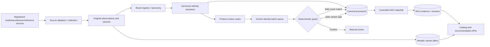

# SkinSync system architecture and API overview

**Revision:** current-code technical guide, 25 October 2026. The previous single-document 3.0 reference contained outdated endpoint and test-count examples. The authoritative **complete** route list is now [api-reference.md](api-reference.md), and the comprehensive table/column definitions are in [database-reference.md](database-reference.md).

## 1. Purpose and system shape

SkinSync aggregates cosmetic/skincare product observations from registered manufacturers, retailers and reference sites; maintains durable canonical identities distinct from retailer inventory; curates ingredient evidence; and provides catalog, price intelligence, formulation similarity and user recommendation APIs.

The four operational flows are deliberately independent:

1. Product discovery/classification/uniqueness (may create provisional identities and first offers).
2. Existing offer stock and price refresh (does not discover products).
3. Canonical INCI retrieval/publication (does not crawl for new products or update offers).
4. AI queues (INCI Jev/Gemini, and a separate Gemini **product identity** queue).

## 2. Implementation map

| Concern | Source modules |
|---|---|
| FastAPI app, auth, routers | `api/app.py`, `api/security/admin.py`, `api/routers/*` |
| Legacy Shopify harvester | `api/pipeline/harvester.py`, `api/pipeline/daily_sync.py` |
| New source adapters/registry and HTTP | `api/pipeline/source_adapters/*`, `api/pipeline/source_registry.py`, `api/pipeline/source_collection.py` |
| Source observations and matching | `api/pipeline/aggregation_service.py`, `api/pipeline/canonical_identity_resolver.py`, `api/pipeline/brand_registry.py` |
| Rich product taxonomy and exclusions | `api/pipeline/taxonomy_service.py`, `api/pipeline/identity_gates.py` |
| Offers, prices, sizes | `api/pipeline/offer_service.py`, `api/services/price_service.py` |
| Legacy reconciliation and reviews | `api/pipeline/legacy_identity_reconcile.py`, `api/pipeline/review_service.py`, `api/pipeline/identity_review.py` |
| Gemini product identity worker | `api/pipeline/product_identity_gemini.py` |
| Apply stored Gemini results without model calls | `api/pipeline/saved_gemini_decisions.py` |
| INCI source waterfall and publisher | `api/pipeline/waterfall_inci_resolver.py`, `api/pipeline/formulation_service.py`, `api/pipeline/source_formulations.py`, `api/pipeline/waterfall_readiness.py` |
| INCI model queues | `api/pipeline/jev_worker.py`, `api/pipeline/gemini_worker.py`, `api/pipeline/queue_runner.py` |
| Job/task telemetry | `api/pipeline/task_tracker.py`, `api/routers/tasks.py` |
| SQLite schema and migrations | `api/pipeline/db_manager.py`, `api/pipeline/aggregation_schema.py` |
| Admin UI | `skinsync-app/src/AdminObservatory.jsx`, `CatalogWorkflowsPanel.jsx`, `AggregationReviewPanel.jsx`, `GeminiDecisionsTable.jsx` |

## 3. Identity: model versus application

The central durable object is `canonical_products.id`. Source title/brand/variants are evidence, not authority to merge. Retailer-specific offers can have different SKUs/pack sizes but represent the same marketed formula. Hard identity gates distinguish SPF strengths, dosage/concentration, fragrance, tint/shade, usage timing and formulation vehicle, while brand aliases are validated.

Incoming product observations are classified via rich taxonomy, linked to existing identities when safe, or staged as provisional with review cases. Legacy exact-match verification is a separate bounded step; conflicting identities are not mass-certified to inflate INCI eligibility.

**Gemini identity** processes multiple review cases per API call, stores its verdict and numeric confidence in `identity_gemini_queue`, and records application state separately. A `same_product` verdict ≥0.90 can verify a single canonical identity only after independent brand, source evidence, variant/INCI and duplicate checks. A confident `different_product` verdict is **not approval**: a safe explicit partition can trigger an audited split; otherwise the case requires structural resolution. LLM model confidence is not a calibrated claim of truth.

Saved-decision replay reuses previously persisted Gemini verdicts, with no new provider calls, and protects against stale evidence by hashes. The [Gemini workflow guide](aggregation/gemini-product-identity-review.md) and [saved verdict guide](aggregation/saved-gemini-decisions.md) specify the operations.

## 4. INCI separation

Ingredient list source evidence and canonical authoritative formulation are different states. The resolver can retrieve retailer/manufacturer/reference evidence through its waterfall; the publisher checks complete/non-truncated list, ordered tokens, exact source/product identity, regional formulation compatibility and conflict/version policy before an authoritative write. Partial descriptions, "key actives", generic INCI database hits, and LLM matching alone cannot establish an exact published formula.

Current authoritative fields are on `canonical_products`; `inci_audit_evidence` records candidate/rejected/approved evidence and `formulation_versions` tracks historical published versions. Identity verification does **not** automatically make all existing INCI columns authoritative.

## 5. Runtime and persistence

- FastAPI application: `api/app.py`; user endpoints include recommendations, search, similarity, prices and dermatology. Admin APIs provide source collection, reconciliation, review, INCI, queues and telemetry.
- React 19/Vite 7 admin and consumer UI; default development origin `localhost:5173`.
- SQLite3 with WAL and foreign key enforcement; `SKINSYNC_DB_PATH` selects the file. See [full database documentation](database-reference.md).
- Task records are persistent in `pipeline_tasks`; some INCI admin progress is process-local telemetry. UI receipt of `task_id` is not proof of task completion. Source rate limits and API quota logs are distinct.
- Security: admin Bearer tokens and scoped capability authorization; requests to admin endpoints must carry a valid token. See [operations/security](workflows-and-operations.md).

## 6. API boundaries

Read the [complete HTTP API reference](api-reference.md) rather than relying on older static endpoint lists. It covers every declared router on `main`, including:

- `/admin/workflows/products/discover-multiple` and task status/cancel;
- `/admin/workflows/offers/refresh`;
- `/admin/workflows/products/verify-existing` and `prepare-reviews`;
- `/admin/aggregation/reviews/gemini/*` identity enqueue, worker execution, saved replay, sortable result history;
- `/admin/waterfall/batch/*` INCI eligibility/start/status/cancel; `/admin/queues/*` INCI model queues;
- regular `/recommend`, `/search`, `/products/{product_id}/price-comparison`, `/similarity/score` and the rest of the documented families.

Pydantic schemas exposed by FastAPI `/openapi.json` are definitive for input validation on a deployed version.

## 7. Operational readiness and test posture

- Local verified reference interpreter: Python 3.12 per CI, Node 22 per frontend CI. The existing `api/Dockerfile` still uses Python 3.9 and should be aligned before container deployment.
- `api/tests/run_regressions.py` tests a disposable SQLite snapshot with mocked network providers. `.github/workflows/regressions.yml` runs backend regressions and frontend checks.
- A green test suite does not certify live data, external source crawl completion, regional formulation identity, Gemini quota availability or active production deployment.
- Follow the [operations runbook](workflows-and-operations.md) for backups, dry-run sequencing, source evaluation, review backlogs and recovery.

## 8. Known boundaries

The repository retains legacy `daily_sync.py` / `products/refresh` flows alongside the newer separated operations. Shopify catalog scanning can run to exhaustion; other source adapters generally need explicit/known URLs. Existing offer refresh is finite and synchronous. Gemini cannot silently merge distinct canonical IDs and cannot override an unverified INCI formula.

Detailed historical research is preserved in [SOTA evaluation](sota_architecture_evaluation.md) and the [original enhancement plan](enhancement_plan.md), but those reports should not be cited as proof of current production state.
