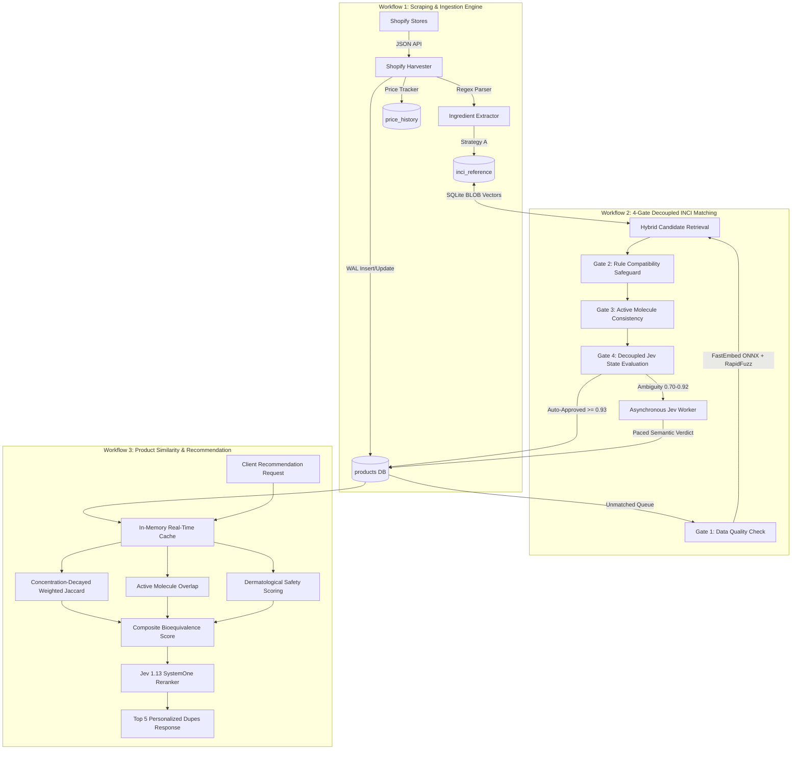
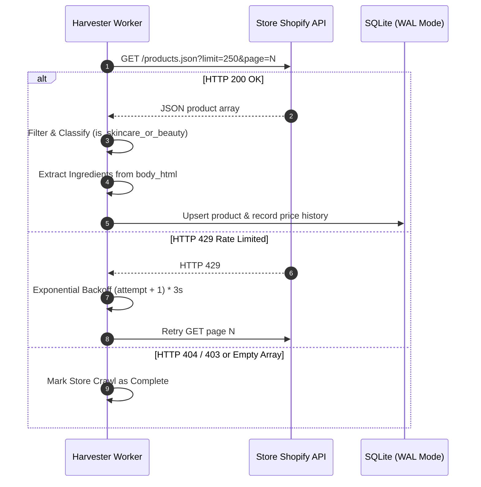
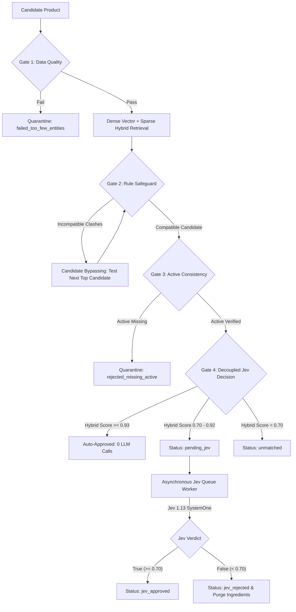

# SkinSync Technical Design Document (TDD)
## Core Workflows: Ingestion, INCI Matching & Bioequivalence Scoring

**Document Version:** 3.1  
**Status:** Production Reference Architecture  
**System:** SkinSync AI Engine  
**Repository Paths:** [`repo/api/pipeline/`](file:///mnt/windows/Users/AmrAlfayoumy/Downloads/skincare/repo/api/pipeline), [`repo/api/app.py`](file:///mnt/windows/Users/AmrAlfayoumy/Downloads/skincare/repo/api/app.py)

---

## 1. System Architecture Overview

SkinSync transforms unstructured multi-store e-commerce feeds into a verified, clinically validated skincare knowledge base. It provides real-time cosmetic dupe matching, price change auditing, and personalized bioequivalence scoring.



---

## 2. Workflow 1: Scraping and Ingestion Engine

### 2.1 Purpose & Scope
The ingestion workflow continuously captures catalog updates, product availability, real-time prices, and raw ingredient statements from 6 primary Egyptian skincare e-commerce retailers without relying on brittle HTML DOM scrapers.

### 2.2 Store Coverage & Endpoint Specifications
All primary sources expose native Shopify `/products.json` pagination interfaces:

| Store Identifier | Display Name | Domain | Default Delay |
| :--- | :--- | :--- | :--- |
| `sourcebeauty` | Source Beauty | `sourcebeauty.com` | `0.30s` |
| `feel22` | Feel22 Egypt | `eg.feel22.com` | `0.30s` |
| `bloompharmacy` | Bloom Pharmacy | `www.bloompharmacy.com` | `0.30s` |
| `drdawood` | Dr Dawood Pharmacy | `drdawoodstore.com` | `0.40s` |
| `bashrety` | Bashrety | `bashrety.tv` | `0.40s` |
| `rawafrican` | Raw African | `rawafrican.net` | `0.40s` |

### 2.3 Harvesting Execution & HTTP Resilience
Implemented in [`repo/api/pipeline/harvester.py`](file:///mnt/windows/Users/AmrAlfayoumy/Downloads/skincare/repo/api/pipeline/harvester.py):



1. **Pagination Engine:** Pages are requested sequentially starting at `page=1` up to `DEFAULT_MAX_PAGES_PER_STORE` (default: 40, yielding up to 10,000 products per store).
2. **Exponential Backoff:** If an HTTP 429 occurs, the worker sleeps for $(attempt + 1) \times 3$ seconds before retrying up to `SHOPIFY_MAX_RETRIES` (default: 3).
3. **Pacing Delay:** A deliberate per-page sleep (`SHOPIFY_DEFAULT_DELAY_SECONDS`, 0.30–0.40s) prevents IP blocks.

### 2.4 Classification & Extraction Logic
- **Scope Filter ([`pipeline/classifier.py`](file:///mnt/windows/Users/AmrAlfayoumy/Downloads/skincare/repo/api/pipeline/classifier.py)):** Excludes non-skincare items (apparel, accessories, candle, tools) via title and product type negative pattern matching.
- **Categorization:** Maps products into standard categories: `Serum`, `Moisturizer`, `Cleanser`, `Sunscreen`, `Toner`, `Exfoliator`, `Eye Care`, `Lip Care`.
- **HTML Ingredient Block Extraction:**
  Uses regular expression lookahead to isolate the chemical formula from instructions, marketing claims, and warnings:
  ```python
  patterns = [
      r'(?:ingredients|key ingredients|active ingredients|composition|formula|المكونات)\s*[:：\n]([\s\S]+?)(?=\n\s*(?:how to use|directions|benefits|warning|precautions|features|size|volume|suitable for|$))',
      r'(?:ingredients|key ingredients)\s*[:：\n]([\s\S]+)'
  ]
  ```
  Minimum extraction threshold: $\ge 12$ characters and $\ge 3$ whitespace or comma-separated tokens.

### 2.5 Strategy A: Store Self-Enrichment
When a store's product description contains an explicit, high-quality ingredient block ($\ge 20$ characters, known vendor), the ingestion engine immediately saves this formulation into `inci_reference` under `source = 'store_verified'`. This allows other stores lacking description ingredients to match and reuse the formulation.

### 2.6 Price Tracking & SQLite WAL Concurrency
- **Price Delta Audit:** If $|P_{\text{old}} - P_{\text{new}}| > 0.01\text{ EGP}$ and $P_{\text{new}} > 0$, an immutable record is inserted into `price_history`.
- **WAL Mode Execution:** The database runs with `PRAGMA journal_mode = WAL;` and `PRAGMA busy_timeout = 5000;`. Scraping jobs write large batch transactions without blocking the FastAPI read requests.
- **Sync Runs Log:** Each execution logs `started_at`, `completed_at`, `products_fetched`, `products_added`, `products_updated`, and `price_changes` in `sync_runs`.

---

## 3. Workflow 2: 4-Gate Decoupled INCI Matching Engine

### 3.1 Decoupling Rationale
Historically, crawlers halted synchronously when calling rate-limited AI models. The 4-gate architecture separates **Phase 1 (Store Crawling & Gates 1–3)** from **Phase 2 (Asynchronous Gate 4 Jev Verification)**, ensuring fast, uninterrupted ingestion.



### 3.2 Gate 1: Data Quality Validation
- Validates that the raw ingredient string has a minimum character length:
  $$\text{length}(\text{raw\_text}) \ge \text{cfg.MIN\_INGREDIENT\_RAW\_LEN} \quad (12\text{ chars})$$
- Tokenizes string by delimiters `[,;•\n\r/]+` and asserts:
  $$|\text{Distinct Chemical Entities}| \ge \text{cfg.MIN\_INGREDIENT\_COUNT} \quad (3\text{ entities})$$
- Formulations failing Gate 1 are assigned `gate1_quality_status = 'failed_too_few_entities'` and quarantined.

### 3.3 Retrieval Layer: Dense ONNX Vectors + Sparse Token Hybrid
1. **Dense Vector Search (FastEmbed ONNX):**
   - Model: `BAAI/bge-small-en-v1.5` (384 dimensions).
   - Rather than using FAISS or an external vector database, embeddings are stored directly in SQLite as binary BLOBs (`FLOAT32` byte buffers, $384 \times 4 = 1,536\text{ bytes}$ per row).
   - Searches are pre-filtered by brand, reducing candidate arrays to $10 - 200$ items.
   - Vector dot product cosine similarity runs via NumPy in **$0.044\text{ ms}$** on CPU:
     $$\text{Sim}_{\text{dense}} = \frac{\vec{q} \cdot \vec{d}}{\|\vec{q}\| \|\vec{d}\|}$$
2. **Sparse Token Matcher (RapidFuzz):**
   - Computes normalized Levenshtein token sort ratio:
     $$\text{Sim}_{\text{sparse}} = \frac{\text{token\_sort\_ratio}(\text{Title}_A, \text{Title}_B)}{100.0}$$
3. **Hybrid Combination:**
   $$S_{\text{hybrid}} = (\text{cfg.DENSE\_VECTOR\_WEIGHT} \times \text{Sim}_{\text{dense}}) + (\text{cfg.SPARSE\_TOKEN\_WEIGHT} \times \text{Sim}_{\text{sparse}})$$
   *(Defaults: $0.55 \times \text{Sim}_{\text{dense}} + 0.45 \times \text{Sim}_{\text{sparse}}$)*

### 3.4 Gate 2: Deterministic Rule Compatibility Safeguard
Naïve fuzzy/vector search frequently matches cosmetic variants of the same brand line that are chemically incompatible. [`pipeline/safeguards.py`](file:///mnt/windows/Users/AmrAlfayoumy/Downloads/skincare/repo/api/pipeline/safeguards.py) deterministically checks 8 incompatibility dimensions:

1. **Anatomical Target:** Hair vs. Face (*hair mask vs face mask*), Lip vs. Eye/Face, Eye Contour vs. Full Face, Body vs. Face.
2. **Vehicle Phase:** Rinse-off Cleansers/Soaps/Scrubs vs. Leave-on Creams/Serums/Balms; Leave-on Toners vs. Rinse-off Washes.
3. **Viscosity & Texture:** Liquid Serums vs. Emulsion Creams; Oil-Control Fluids vs. Rich Creams; Oil-Free Gels vs. Lipid Lotions.
4. **Sun Protection:** SPF Sunscreens vs. Non-SPF daily balms.
5. **Circadian Regimen:** Day / AM vs. Night / PM / Overnight.
6. **Finish & Pigmentation:** Tinted / BB / CC vs. Untinted / Invisible / Clear.
7. **Brand Sub-Line Collisions:** Bioderma (*Sébium* $\neq$ *Sensibio* $\neq$ *Atoderm*); La Roche-Posay (*Effaclar* $\neq$ *Toleriane* $\neq$ *Anthelios* $\neq$ *Cicaplast*).
8. **Active Chemical Family & Potency:** Glycolic Acid $\neq$ Niacinamide; Retinol 0.1% $\neq$ 0.3%; Reedle Shot $50 \neq 100 \neq 300$.

> [!IMPORTANT]
> **Candidate Bypassing:** When candidate #1 triggers a safeguard violation (e.g., matching *Cicaplast Baume B5+ SPF50* against *Cicaplast Baume B5* non-SPF), the engine does not abort. It records a bypass log, skips candidate #1, and evaluates candidates #2 through #5 until the true SPF50 formulation is found.

### 3.5 Gate 3: Active Molecule Consistency
Verifies that functional actives promised in the product title (e.g., `Retinol`, `Niacinamide`, `Hyaluronic Acid`, `Salicylic Acid`, `Centella`, `Ceramide`, `Sunscreen UV filters`) are present in the candidate formulation's chemical list:
```python
for claim, markers in ACTIVE_MARKERS.items():
    if re.search(r'\b' + re.escape(claim) + r'\b', title.lower()):
        if not any(m in candidate_ingredients.lower() for m in markers):
            return False, f"rejected_missing_claimed_active_{claim}"
```

### 3.6 Gate 4: Decoupled Jev State Handling
- **Tiers:**
  - $S_{\text{hybrid}} \ge 0.93$: **Auto-Approved**. Fast-path matching requiring 0 LLM calls.
  - $0.70 \le S_{\text{hybrid}} < 0.93$: **Ambiguity Zone**. Ingredients temporarily accepted, but Gate 4 status is set to `'pending_jev'`.
  - $S_{\text{hybrid}} < 0.70$: Discarded as unmatched.
- **Dedicated Worker ([`pipeline/jev_worker.py`](file:///mnt/windows/Users/AmrAlfayoumy/Downloads/skincare/repo/api/pipeline/jev_worker.py)):**
  - Runs asynchronously in small batches (default: 25).
  - Paced at `JEV_REQUEST_INTERVAL_SECONDS` (2.0s) with 10.0s exponential backoff on HTTP 429.
  - If Jev approves ($\text{Noul} \ge 0.70$): sets `gate4_jev_status = 'jev_approved'`, `inci_jev_score = 0.95`.
  - If Jev rejects ($\text{Noul} < 0.70$): sets `gate4_jev_status = 'jev_rejected'`, `inci_jev_score = 0.15`, and **purges** `ingredients_raw`, `ingredients_parsed`, and `actives`.

### 3.7 Strategy B: Open Beauty Facts API Fallback
When local candidates are absent, the matcher queries Open Beauty Facts live API (`world.openbeautyfacts.org/cgi/search.pl`). If retrieved, the candidate must pass Gates 1, 2, and 3 before being persisted into `inci_reference`.

---

## 4. Workflow 3: Product Similarity & Recommendation Engine

### 4.1 Purpose & Mathematical Formulation
Workflow 3 powers the bioequivalence matching engine in [`repo/api/app.py`](file:///mnt/windows/Users/AmrAlfayoumy/Downloads/skincare/repo/api/app.py), finding functional dupes and affordable cosmetic alternatives for a target product.

### 4.2 Concentration-Decayed Weighted Jaccard Similarity
Cosmetic labeling laws mandate that ingredients appear in descending order of concentration (until the 1% line). SkinSync applies an inverse-square-root rank decay weight:

$$w(i) = \frac{1}{\sqrt{i + 1}}, \quad i \in \{0, 1, 2, \dots, N-1\}$$

For target product $A$ and candidate product $B$:

$$\text{Sim}_{\text{Jaccard}}(A, B) = \frac{\sum_{k \in A \cup B} \min(w_A(k), w_B(k))}{\sum_{k \in A \cup B} \max(w_A(k), w_B(k))}$$

Where $w_A(k) = 0$ if ingredient $k \notin A$. This strongly rewards overlap among the primary vehicle and early actives (solvents, emollients) while reducing the impact of trace preservatives and fragrance at the end of the list.

### 4.3 Active Molecule Overlap Index
Active ingredients dictate biological efficacy. The active similarity is defined as the Jaccard index over detected functional active categories:

$$\text{Sim}_{\text{Active}}(A, B) = \begin{cases} 
\frac{|Actives(A) \cap Actives(B)|}{|Actives(A) \cup Actives(B)|} & \text{if } Actives(A) \cup Actives(B) \neq \emptyset \\
0.50 & \text{if } Actives(A) = Actives(B) = \emptyset \\
0.10 & \text{if one has actives, other is empty}
\end{cases}$$

### 4.4 Title Token Similarity
$$\text{Sim}_{\text{Title}}(A, B) = \frac{|\text{Tokens}(A) \cap \text{Tokens}(B)|}{|\text{Tokens}(A) \cup \text{Tokens}(B)|}$$
*(Calculated after stripping cosmetic stopwords: `the`, `and`, `with`, `for`, `skin`, `ml`, `g`, `face`)*

### 4.5 Composite Formulation Bioequivalence
When both products possess verified INCI lists:
$$\text{Sim}_{\text{Formula}} = (0.50 \times \text{Sim}_{\text{Active}}) + (0.35 \times \text{Sim}_{\text{Jaccard}}) + (0.15 \times \text{Sim}_{\text{Title}})$$

If ingredient data is missing for either product:
$$\text{Sim}_{\text{Formula}} = (0.60 \times \text{Sim}_{\text{Active}}) + (0.40 \times \text{Sim}_{\text{Title}})$$

### 4.6 Dermatological Skin Safety Scoring
Personalizes recommendations according to the user's skin type (`oily`, `dry`, `sensitive`, `normal`):

$$\text{Safety Score} = 75.0 + \min(25.0, 4.0 \times \text{Benefit Pts}) - \min(50.0, 10.0 \times \text{Risk Pts})$$
$$\text{Safety Score} \in [20.0, 100.0]$$

#### Skin Benefits Weights
- **Oily:** Salicylic Acid (+3.0), Niacinamide (+2.5), Zinc (+2.5), Tea Tree (+2.0), Centella (+1.5)
- **Dry:** Hyaluronic Acid (+3.0), Ceramides (+3.0), Squalane (+2.5), Vitamin B5 (+2.0), Collagen (+1.5)
- **Sensitive:** Centella (+3.0), Vitamin B5 (+2.5), Ceramides (+2.5), Aloe Vera (+2.0)

#### Comedogenic & Irritancy Risk Penalties
- **Oily:** Isopropyl Myristate (5.0), Isopropyl Palmitate (5.0), Wheat Germ Oil (5.0), Coconut Oil (4.0), Ethylhexyl Palmitate (4.0), Cocoa Butter (3.5)
- **Dry:** Alcohol Denat (4.0), SLS (3.5), Salicylic Acid (1.5)
- **Sensitive:** Fragrance (4.0), Alcohol Denat (4.0), SLS (3.5), AHA (2.5), Retinoids (2.0), Salicylic Acid (2.0)

### 4.7 Final Calibrated Match Score
The final customer-facing score is calibrated to an intuitive percentage ($30.0\% - 98.5\%$):

- **Normal Skin:**
  $$\text{Score}_{\text{final}} = 45.0 + (\text{Sim}_{\text{Formula}} \times 53.0)$$
- **Targeted Skin (Oily / Dry / Sensitive):**
  $$\text{Score}_{\text{final}} = 45.0 + (\text{Sim}_{\text{Formula}} \times 39.0) + \left(\frac{\text{Safety Score}}{100.0} \times 14.5\right)$$

### 4.8 Two-Stage Jev 1.13 Semantic Reranking
When API keys are present (`OPENCODE_API_KEY` or `JEV_API_KEY`), the top 5 candidates undergo second-stage deep semantic calibration via Jev 1.13 SystemOne:

$$\text{Score}_{\text{calibrated}} = (\text{Score}_{\text{final}} \times 0.65) + (\text{Jev Probability} \times 100 \times 0.35)$$

The response returns `ai_verified = True` and displays `ai_confidence` alongside explicit cosmetic risk flags.

---

## 5. Configuration Architecture ([`pipeline/config.py`](file:///mnt/windows/Users/AmrAlfayoumy/Downloads/skincare/repo/api/pipeline/config.py))

All magic numbers are managed by the typed `PipelineConfig` class and can be overridden via `.env`:

| Workflow | Parameter | Default | Environment Key |
| :--- | :--- | :--- | :--- |
| **Ingestion** | Shopify Page Limit | `250` | `SHOPIFY_PAGE_LIMIT` |
| **Ingestion** | Per-Page Request Delay | `0.35s` | `SHOPIFY_DEFAULT_DELAY_SECONDS` |
| **Ingestion** | Max Retries on 429 | `3` | `SHOPIFY_MAX_RETRIES` |
| **Ingestion** | Page Depth Per Store | `40` | `DEFAULT_MAX_PAGES_PER_STORE` |
| **Ingestion** | Price Change Epsilon | `0.01 EGP` | `PRICE_DIFFERENCE_THRESHOLD` |
| **INCI Matching**| Min Ingredient Entities | `3` | `MIN_INGREDIENT_COUNT` |
| **INCI Matching**| Min Raw String Length | `12` | `MIN_INGREDIENT_RAW_LEN` |
| **INCI Matching**| Max Raw String Truncation | `2500` | `MAX_INGREDIENT_RAW_LEN` |
| **INCI Matching**| FastEmbed ONNX Model | `bge-small-en-v1.5` | `FASTEMBED_MODEL_NAME` |
| **INCI Matching**| Dense Vector Weight | `0.55` | `DENSE_VECTOR_WEIGHT` |
| **INCI Matching**| Sparse Token Weight | `0.45` | `SPARSE_TOKEN_WEIGHT` |
| **INCI Matching**| Top-K Candidate Pool | `5` | `TOP_K_CANDIDATES` |
| **INCI Matching**| Auto-Approve Threshold | `0.93` | `AUTO_APPROVE_HYBRID_THRESHOLD` |
| **INCI Matching**| Ambiguity Zone Low Cutoff | `0.70` | `AMBIGUITY_ZONE_LOW_THRESHOLD` |
| **INCI Matching**| Jev Request Pacing Delay | `2.0s` | `JEV_REQUEST_INTERVAL_SECONDS` |
| **INCI Matching**| Jev HTTP 429 Backoff | `10.0s` | `JEV_RATE_LIMIT_BACKOFF_SECONDS` |
| **INCI Matching**| Jev Confidence Cutoff | `0.70` | `JEV_CONFIDENCE_THRESHOLD` |
| **Similarity** | Active Weight | `0.50` | In-Engine Parameter |
| **Similarity** | Weighted Jaccard Weight | `0.35` | In-Engine Parameter |
| **Similarity** | Title Similarity Weight | `0.15` | In-Engine Parameter |
| **Similarity** | Jev Reranking Weight | `0.35` | In-Engine Parameter |

---

## 6. End-to-End Trace Example: Cicaplast Baume B5+ SPF50

```
Input: "La Roche-Posay Cicaplast Baume B5+ SPF 50" (Source Beauty)
  │
  ├── [Workflow 1: Ingestion]
  │     ├── Shopify /products.json -> Extracted Title, Price: 850 EGP
  │     ├── Regex extract body_html -> Found raw chemical list
  │     └── Strategy A -> Ingested into inci_reference (store_verified)
  │
  ├── [Workflow 2: INCI Matching]
  │     ├── Gate 1: 34 chemical entities parsed -> PASSED
  │     ├── Retrieval: FastEmbed dot-product on LRP brand -> 5 candidates retrieved
  │     │     ├── Cand 1: "Cicaplast Baume B5" (Score: 0.94) -> Gate 2 FAIL (SPF vs Non-SPF clash)
  │     │     ├── Cand 2: "Cicaplast Gel B5" (Score: 0.89)   -> Gate 2 FAIL (Gel vs Balm clash)
  │     │     └── Cand 3: "Cicaplast Baume B5+ SPF50" (Score: 0.98) -> Gate 2 & Gate 3 PASSED
  │     ├── Gate 4: Hybrid score 0.98 >= 0.93 -> AUTO-APPROVED (0 LLM calls)
  │     └── DB Write: Saved formulation + audit telemetry in skincare.db
  │
  └── [Workflow 3: Dupe Recommendation]
        ├── Target: LRP Cicaplast Baume B5+ SPF50 (850 EGP)
        ├── Query: User skin type = "sensitive"
        ├── Candidate Evaluation:
        │     ├── Local alternative: "Eva Skin Clinic Soothing Cica Balm SPF50" (220 EGP)
        │     ├── Active Match: Madecassoside + Panthenol + UV Filters -> 1.0 Active Sim
        │     ├── Formula Weighted Jaccard: 0.74 (shared shea, glycerin, zinc)
        │     ├── Skin Safety Score: 94.0/100 (Centella & B5 benefit points, 0 fragrance)
        │     ├── Match Score: 89.2% (Budget dupe, 74% price savings)
        │     └── Gate 4 Jev Reranker: 92% Bioequivalence -> Calibrated Final Score: 90.2%
        └── Result: Returned in UI as #1 Verified Dupe
```
